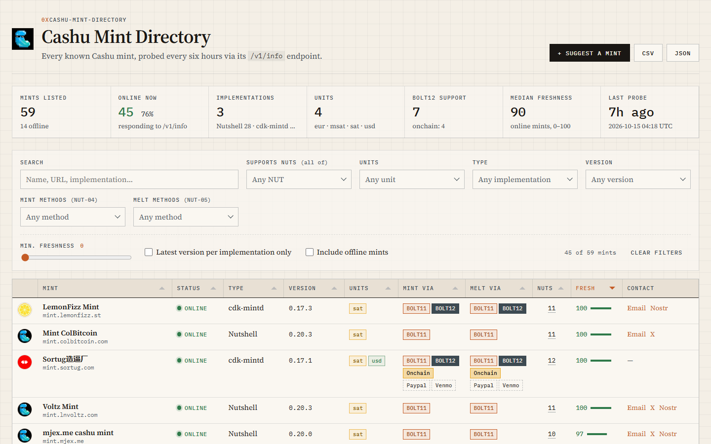

# Cashu Mint Directory

An interactive directory of Cashu mints.

**[Open the interactive table](https://ye0man.github.io/cashu-mint-directory/)**



The site is a single static page (no build step) in [`docs/`](./docs): [`index.html`](./docs/index.html), [`assets/styles.css`](./docs/assets/styles.css), and [`assets/app.js`](./docs/assets/app.js). It uses [Tabulator](https://tabulator.info/) (pinned, with SRI), is fed by [`docs/mints.json`](./docs/mints.json), and supports sorting, filtering, column resizing/reordering, and CSV/JSON export of the filtered rows. When embedded in an `<iframe>` it switches to a compact layout with a transparent background.

The data is compiled from the [Awesome Cashu](https://github.com/cashubtc/awesome-cashu) repo, community submissions, and direct queries to each mint's `/v1/info` endpoint.

## Features

- **Summary cards**: total mints, online share, implementations, units, BOLT12/onchain support, median freshness, and time of the last probe.
- **Filters**: free-text search, supported NUTs (all of), units, implementation, version, NUT-04 mint methods, NUT-05 melt methods, minimum freshness, "latest version per implementation only", and an offline toggle. **Clear filters** resets everything.
- **Readable status**: green/red online/offline indicators, colour-coded payment-method chips (BOLT11, BOLT12, Onchain, and other/fiat methods), and struck-through methods when minting or melting is disabled.
- **Responsive**: on narrow screens, lower-priority columns collapse into an expandable row.
- **Suggest a mint**: see below.
- **Resources**: links to the NUTs spec, Mint Auditor, Cashu docs, and more in the footer.

## Suggesting a mint

1. Click **Suggest a mint** on the site (or open a [*Suggest a mint* issue](https://github.com/ye0man/cashu-mint-directory/issues/new?template=suggest-mint.yml)). The dialog can test the mint's `/v1/info` from your browser first.
2. [`.github/workflows/mint-submission.yml`](./.github/workflows/mint-submission.yml) normalizes the URL, rejects duplicates and non-public hosts, probes `/v1/info`, and posts a report comment (updated in place if the issue is edited). The issue is labelled `validated` or `needs-attention`.
3. A maintainer comments **`approved`**. The workflow re-validates, adds the URL to [`data/manual_mints.txt`](./data/manual_mints.txt) on a branch, and opens a pull request that closes the issue.
4. Merging the PR triggers the update workflow, which probes the new mint and adds it to `docs/mints.json`.

Validation logic lives in [`scripts/mint_submission.py`](./scripts/mint_submission.py) and can be run locally:

```sh
python scripts/mint_submission.py validate --url https://mint.example.com --report report.md
```

> The approval step needs **Settings → Actions → General → Allow GitHub Actions to create and approve pull requests** to be enabled.

## Automated updates

A GitHub Actions workflow ([`.github/workflows/update-mints.yml`](./.github/workflows/update-mints.yml)) runs every 6 hours, and whenever `data/manual_mints.txt` changes on `main`, and probes every discovered mint. If any data changes, it commits the updated `docs/mints.json` directly to `main`. You can also trigger it manually from the **Actions** tab.

The update script lives at [`scripts/update_mints.py`](./scripts/update_mints.py).

## Local development

```sh
cd docs && python -m http.server 8000
# open http://localhost:8000
```

## Data fields

Each mint record includes:

- `name`, `url`, `implementation`, `version`
- `nuts`: array of supported **optional** NUTs (e.g. `[7, 8, 9, ...]`)
- `units`: supported currency units (e.g. `["sat"]`), with aliases normalized
- `stale_score`: freshness score from 0–100 (higher is better)
- `stale_reasons`: signals that lowered the score
- `status`: `online` or `offline`
- `last_seen`: ISO timestamp of the last probe
- `mint_methods`, `melt_methods`: arrays of structured method objects, e.g. `[{"method": "bolt11", "units": ["sat", "usd"]}]`. The table renders each method as a chip and shows its supported units on hover.
- `nut4_disabled`, `nut5_disabled`: whether minting/melting is disabled
- contact fields: `email`, `x`, `nostr`, `other_contact` (rendered in the table as a single **Contact** column with hyperlinks)

## Freshness scoring

The freshness score is computed from:

| Signal | Weight | Note |
|---|---|---|
| Online | 40 | Must return HTTP 200 with a valid `nuts` object |
| NUT support | 25 | Relative to the median optional-NUT count |
| Version age | 20 | Known implementations older than 180 days lose points |
| Contact info | 10 | Bonus for email, X, nostr, or other contact |
| Units discoverable | 5 | Bonus when mint/melt methods expose units |

By default the table hides offline mints. Toggle **"Include offline mints"** to see the full list, or use the **Min. freshness** slider to hide stale ones.
